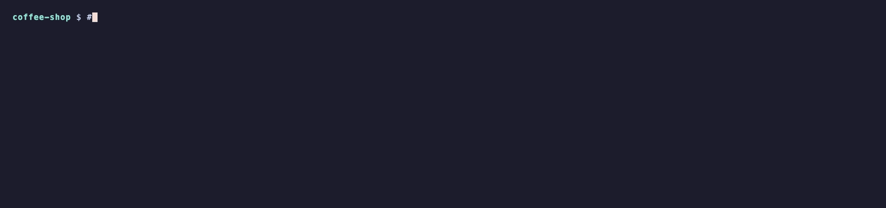

# Cortado ☕

**Serving up fresh stats for your Claude Code sessions.**

Cortado is a statusline for [Claude Code](https://docs.anthropic.com/en/docs/claude-code). It shows context usage, rate limits, session cost, git status and more on one line, and you choose which modules appear and in what order.


<p align="center">
  
</p>

Cortado started as a fork of [Barista](https://github.com/pstuart/Barista) by Patrick D. Stuart and is now its own project. Coming from Barista? Your settings carry over: see [Migrating from Barista](docs/migrating-from-barista.md).

## Install

You need Claude Code, macOS or Linux (including WSL), and `jq` (`brew install jq` on macOS).

```bash
git clone https://github.com/gcko/Cortado.git
cd Cortado
./install.sh
```

The installer asks which modules you want and how they should look, shows a preview, and backs up your current statusline. Restart Claude Code to see the new one. To skip the questions and install the core modules, run `./install.sh --defaults`.

It also adds a `cortado` command in `~/.local/bin`, so you can run `cortado config` from any terminal. If that directory is not on your `PATH`, the installer prints the line to add to your shell's startup file. `cortado update` installs the latest release, `cortado setup` points Claude Code at Cortado again, and `cortado help` lists every command.

[Installing and updating](docs/install.md) covers every installer option, updates, manual installation and the full requirements.

## What's New in v2.0.0 🆕

The first release of Cortado as its own project.

- Barista is now Cortado. Your Barista settings carry over: see [Migrating from Barista](docs/migrating-from-barista.md).
- Config files are read as data and never run. Lines that run commands are skipped; `cortado config --migrate --dry-run` lists them.
- Cortado refuses a config file it can't prove is yours, and says so with `Config refused`.
- Rate limits need no credential, spend-limit usage is shown when Claude Code sends it, and a missing reading always shows `--`.
- A custom module is one file in `cortado-modules/`.

The [changelog](CHANGELOG.md) has the full list, including every breaking change, and the Barista releases before it.

## Modules

Core modules are on by default. The others are off until you turn them on.

### Core

| Module | Shows |
|--------|-------|
| **directory** | The current directory name |
| **context** | Context window usage as a progress bar, with a warning before auto-compact |
| **git** | Branch, and staged, modified and untracked changes |
| **project** | The project type: Node.js, Nuxt, Next.js, Vite, Rust, Go, Python, Swift and more |
| **model** | The Claude model, output style, and optionally thinking and effort (`MODEL_SHOW_THINKING`) |
| **cost** | Session cost, burn rate ($/hour) and tokens per minute |
| **rate-limits** | 5-hour and 7-day usage with projections, and gateway spend when Claude Code sends it |
| **time** | Date and time |
| **battery** | Battery level (macOS) |
| **sandbox** | A lock icon when running inside a macOS app sandbox |
| **version** | The Cortado version, briefly, at the start of each session |
| **update** | A notice when a new Cortado release is out (checked once a day by default) |

### System

| Module | Shows |
|--------|-------|
| **cpu** | CPU usage |
| **memory** | RAM usage |
| **disk** | Disk space |
| **network** | IP address and network info |
| **uptime** | System uptime |
| **load** | Load average |
| **temperature** | CPU temperature (needs `osx-cpu-temp`) |
| **brightness** | Screen brightness |
| **processes** | Total and running process counts |

### Dev tools and extras

| Module | Shows |
|--------|-------|
| **docker** | Docker container status |
| **node** | Node.js version |
| **weather** | Current weather from wttr.in |
| **timezone** | Clocks for other time zones |

## Reading the statusline

A typical line:

```
📁 coffee-shop | 📊 ███░░░░░ 41% 🟢 (78k→⚡) | 🌿 main [●+] 📝 2 | 📦 Node.js 🚀 | 🤖 Opus 5.5 | 💰 $1.84 @$2.45/h | 5h:38% 🟢 (1h 51m) 7d:71% 🟡 (3d 11h) | 📅 11/27 🕐 09:23 AM | 🔋 100% ⚡
```

The same session with the monochrome theme in compact mode:

```
DIR: coffee-shop|CTX: ███░░░░░ 41%[OK] (78k→⚡)|GIT: main [●+]|Node.js 🚀|MODEL: Opus 5.5|COST: $1.84|5h:38%[OK] 7d:71%[MED]|TIME: 11/27 09:23 AM|BAT: 100% ⚡
```

Context usage has three levels:

| Indicator | Context used |
|-----------|--------------|
| 🟢 | Below 60% |
| 🟡 | 60% to 75% |
| 🔴 | Above 75% |

Rate limits have four:

| Indicator | Limit used |
|-----------|------------|
| 🟢 | Below 50% |
| 🟡 | 50% to 75% |
| 🟠 | 75% to 95% |
| 🔴 | Above 95% |

### When Cortado has no reading

Cortado shows `--` when it doesn't know a value, rather than a zero or a green light that looks real.

| Reading | What you see, and when |
|---|---|
| Context | `--` until Claude Code reports usage. Every new session starts that way. |
| Rate limits | `--` for a window with no reading, for example `5h:42% 7d:--`. A new session shows `5h:-- 7d:--` until its first reply. A window whose reset time has passed also shows `--`, because the old reading no longer describes your account. |
| Cached rate limits | When a fetch fails, Cortado serves the last cached reading. If it is older than `RATE_CACHE_TTL`, its age follows the percentage, for example `5h:42%~6h0m`. |
| Gateway spend | Each reading Claude Code sends, for example `spend:$12.40/$50.00 (25% 🟢)`. The percentage arrives with each response, and Claude Code refreshes the dollar estimate about every five minutes while requests are active. The segment is left out when there is no usable reading, or when the dollar limit is zero or less. |
| Update | `⬆ --` (`UPD: --` in ASCII mode) when the release check failed. It tries again on the next render after the failure cache expires, within an hour. A successful check is cached for a day by default. |
| Background readings | Weather, network, CPU, load, brightness, processes, Docker and Node.js show `--` until their first refresh finishes. |

## Configure

Change settings at any time with `cortado config`:

```bash
cortado config                              # Interactive menu
cortado config --toggle weather             # Turn a module on or off
cortado config --set COLOR_THEME=monochrome # Change one setting
cortado config --show                       # Print your current settings
```

Your settings live in `~/.claude/cortado.conf` (or `$CLAUDE_CONFIG_DIR/cortado.conf`), one `KEY="value"` per line, and you can edit the file directly. A project can have its own `.cortado.conf` for display settings.

[Configuring Cortado](docs/configuration.md) lists every setting, the config file rules, per-project settings and some presets.

## Custom modules

A module is a single Bash file. Put your own in `~/.claude/cortado-modules/` and add it to `MODULE_ORDER`. [Writing a custom module](docs/custom-modules.md) walks through it.

## Troubleshooting

- Run `cortado doctor` first. It checks `jq`, Perl, your `settings.json`, config file permissions, the platform and `cortado.log`, and prints the command that fixes each problem.
- If rate limits show `--`, send a message. Claude Code includes usage only after a session's first reply.
- If the line starts with `Config refused` or `Config partly read`, run `cortado config --show` to see which file or line was skipped, and why.
- If a module is missing, set `DEBUG_MODE="true"`. Module errors then go to `~/.claude/cortado.log` instead of being hidden.

[Troubleshooting](docs/troubleshooting.md) covers these in detail, plus installer problems and how to test the statusline by hand.

## Uninstall

```bash
cortado uninstall          # or, from the clone: ./install.sh --uninstall
```

The installer offers to restore the statusline you had before, and removes the `cortado` command it added.

## Contributing

[AGENTS.md](AGENTS.md) is the contributor guide: architecture, coding conventions, tests and the checks to run before a pull request. Regression tests live in `tests/` and each runs on its own, for example `bash tests/test_utils.sh`.

## Credits

- Forked from [Barista](https://github.com/pstuart/Barista) by [Patrick D. Stuart](https://github.com/pstuart), who built the original modular statusline.
- Inspired by [cc-statusline](https://github.com/chongdashu/cc-statusline) by [@chongdashu](https://github.com/chongdashu).
- Built for [Claude Code](https://docs.anthropic.com/en/docs/claude-code) by Anthropic.

## License

Apache License 2.0. See [LICENSE](LICENSE) for the full text.

Cortado includes code from Barista, which is MIT-licensed. The upstream copyright and permission notice is kept in [NOTICE](NOTICE).

## Maintainer

**Jared Scott** ([@gcko](https://github.com/gcko))

---

<div align="center">

*Cortado v2.0.0 - Because your Claude Code deserves a great statusline.*

</div>
